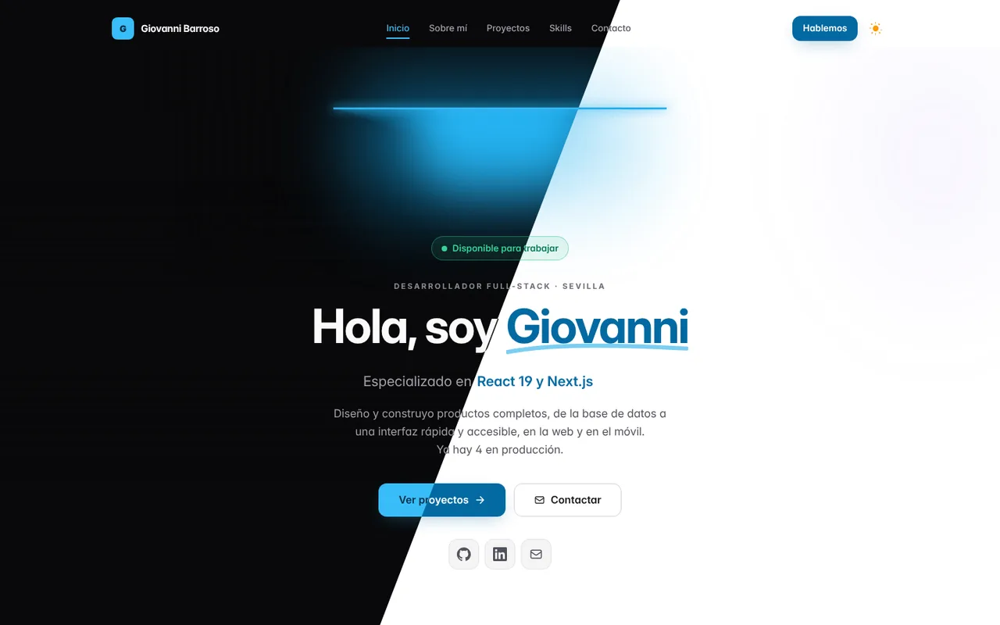

# Portfolio — Giovanni Barroso

Portfolio personal desarrollado con **Vue 3 + TypeScript + Tailwind CSS 4**, desplegado en [giovannibarroso.com](https://giovannibarroso.com).

[](https://github.com/GiovanniBarroso/mi-portfolio/actions/workflows/ci.yml)



## Qué incluye

- **Página propia por proyecto** (`/projects/<slug>`) con descripción completa, lo que se construyó, stack enlazado a los filtros y navegación anterior/siguiente.
- **Filtros por tecnología en la URL** (`/projects?tech=Supabase`) y skills enlazadas a los proyectos donde se han usado.
- **SEO sin depender de JavaScript**: durante el build se genera un HTML por ruta con título, descripción, canonical, Open Graph, Twitter Cards y JSON-LD (`Person`, `WebSite`, `CreativeWork`, migas), además de `sitemap.xml`, `robots.txt` y `404.html`. Así funcionan los enlaces directos en GitHub Pages y las previsualizaciones en LinkedIn o WhatsApp.
- **Imágenes Open Graph** de 1200×630 para la portada y para cada proyecto.
- **Accesibilidad**: navegación completa con teclado, foco gestionado al cambiar de página, menú móvil con foco atrapado, contraste AA verificado en ambos temas, soporte de `prefers-reduced-motion`, `prefers-contrast` y modo de alto contraste. axe-core sin incidencias.
- **Rendimiento**: animaciones con un `IntersectionObserver` propio en lugar de una librería, fuente Inter recortada a latín (352 KB → 74 KB) y PWA que sólo precachea la interfaz.
- **Modo oscuro** sin parpadeo, que sigue al sistema hasta que eliges uno y cambia con una transición circular (View Transitions API).
- **Seguridad**: Content-Security-Policy con hash del único script en línea.

## Stack

- **Vue 3.5** (Composition API + `<script setup>`) con **TypeScript** estricto
- **Vite 7** y **Tailwind CSS 4** (tokens en CSS con `@theme`)
- **Vue Router** con rutas bajo demanda
- **Unhead** para las etiquetas de `<head>` en el navegador
- **vite-plugin-pwa** (Workbox)
- **Vitest**, **ESLint** y **Prettier**; **Husky** + **lint-staged** en cada commit

## Estructura

```
build/         # Plugin de Vite: HTML por ruta, sitemap, robots y CSP
docs/          # Recursos del README (no se publican)
public/
├── og/        # Imágenes Open Graph (generadas con `pnpm og`)
└── resources/ # Capturas de los proyectos (WebP 1280×853)
scripts/       # Optimización de imágenes y generación de imágenes OG
src/
├── components/  # Comunes (tarjetas, cabeceras, iconos…) y de layout
├── composables/ # SEO, portapapeles, carrusel, preferencias de movimiento
├── config/      # SEO del sitio: una definición por página
├── data/        # Contenido: proyectos, skills, sobre mí, datos del sitio
├── directives/  # v-reveal (aparición al hacer scroll)
├── plugins/     # Tema claro/oscuro
├── router/      # Rutas y coordinación de scroll/foco entre páginas
├── utils/       # Helpers de proyectos y normalización de tecnologías
└── views/       # Inicio, Sobre mí, Proyectos, Detalle, Skills, Contacto, 404
```

## Editar el contenido

Todo el contenido vive en `src/data/`, separado de los componentes:

| Quiero…                                        | Fichero                                    |
| ---------------------------------------------- | ------------------------------------------ |
| Cambiar nombre, email, ciudad o disponibilidad | `src/data/site.ts`                         |
| Añadir o editar un proyecto                    | `src/data/projects.ts`                     |
| Cambiar los destacados                         | `FEATURED_SLUGS` en `src/data/projects.ts` |
| Editar skills                                  | `src/data/skills.ts`                       |
| Cambiar textos de SEO                          | `src/config/seo.ts`                        |

Las cifras (número de proyectos, en producción, código abierto…) se calculan solas.

### Añadir un proyecto

1. Guarda la captura en `public/resources/` y ejecuta `pnpm images:optimize` (la recorta a 3:2, la pasa a WebP y elimina metadatos como el GPS).
2. Añade la entrada en `src/data/projects.ts`.
3. Ejecuta `pnpm og` para generar su imagen Open Graph (requiere Playwright: `pnpm dlx playwright install chromium`).
4. `pnpm test` comprueba que no falta nada: imagen, imagen OG, campos y longitudes de SEO.

La página de detalle, el filtro, el sitemap y el HTML estático se generan solos.

## Desarrollo

Requiere Node ≥ 20.19 y pnpm ≥ 9 (la versión exacta está en `packageManager`).

```bash
pnpm install      # instala dependencias
pnpm dev          # servidor de desarrollo
pnpm build        # typecheck + build de producción en dist/
pnpm preview      # previsualiza la build
```

### Calidad de código

```bash
pnpm lint          # ESLint (0 warnings)
pnpm format:check  # Prettier
pnpm test          # Vitest: datos, SEO y plugin de build
pnpm typecheck     # vue-tsc
pnpm ci:check      # todo lo anterior + build (lo mismo que CI)
```

Husky + lint-staged formatean y lintan automáticamente los ficheros de cada commit.

## Despliegue

GitHub Actions: cada PR y cada push a `main` pasan por `ci.yml` (lint, formato, tests, typecheck y build). `deploy.yml` reutiliza ese mismo workflow como puerta y sólo si pasa publica la build en GitHub Pages con el dominio `giovannibarroso.com`. Dependabot propone actualizaciones de dependencias y de actions una vez al mes.
